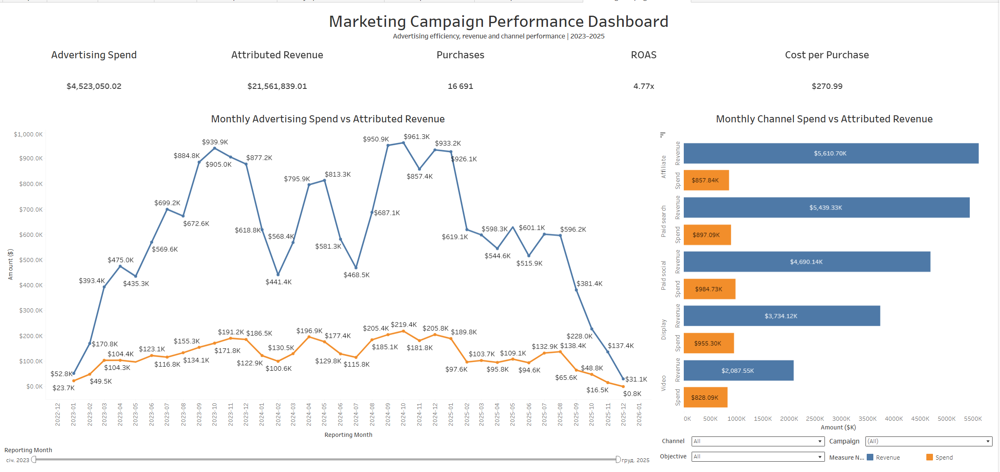

# Marketing Analytics Dashboard

## Project Overview

This project analyzes marketing campaign performance across 120 campaigns, five advertising channels, and three campaign objectives from January 2023 to December 2025.

Marketing data was validated and transformed in BigQuery into campaign-level and monthly analytical datasets. The results are presented in an interactive Tableau dashboard that helps evaluate advertising spend, attributed revenue, purchases, ROAS, and cost efficiency.

Users can explore performance by channel, campaign objective, reporting period, and individual campaign.

## Business Objectives

- Evaluate the performance of marketing campaigns and channels
- Identify the campaigns generating the highest number of conversions
- Compare advertising spend with generated revenue
- Measure customer acquisition efficiency
- Identify opportunities to improve marketing budget allocation

## Key Metrics

- Impressions
- Clicks
- Click-Through Rate (CTR)
- Advertising Spend
- Cost per Click (CPC)
- Leads
- Click-to-Lead Rate
- Cost per Lead
- Trials
- Purchases
- Lead-to-Purchase Rate
- Cost per Conversion
- Cost per Purchase
- Attributed Revenue
- Return on Advertising Spend (ROAS)
- Budget Utilization Rate

## Tools

- SQL / BigQuery
- Tableau
- Excel or Google Sheets
- GitHub

## Documentation

- [Business Insights and Recommendations](docs/business-insights.md)
- [Business Questions](docs/business-questions.md)
- [Analytical Model](docs/analytical-model.md)
- [Metric Definitions](docs/metric-definitions.md)
- [Data Quality Report](docs/data-quality-report.md)
- [Data Profile](docs/data-profile.md)
- [Data Dictionary](docs/data-dictionary.md)

## Interactive Tableau Dashboard

[View the interactive dashboard on Tableau Public](https://public.tableau.com/shared/XGY6R5PK7?:display_count=n&:origin=viz_share_link)

The dashboard includes:

- Advertising Spend, Attributed Revenue, Purchases, ROAS, and Cost per Purchase KPI cards
- Monthly Advertising Spend versus Attributed Revenue trend analysis
- Monthly channel-level Spend versus Attributed Revenue comparison
- Interactive Channel and Objective parameters
- Reporting Month range filter
- Individual Campaign filter

### Dashboard Totals

- **Advertising Spend:** $4,523,050.02
- **Attributed Revenue:** $21,561,839.01
- **Purchases:** 16,691
- **ROAS:** 4.77x
- **Cost per Purchase:** $270.99

The dashboard totals and combined filter interactions were validated against the BigQuery analytical datasets.

## Project Status

✅ Completed — November 2026

The project includes validated source data, reproducible BigQuery transformations, Tableau-ready analytical datasets, an interactive Tableau dashboard, and documented business recommendations.
